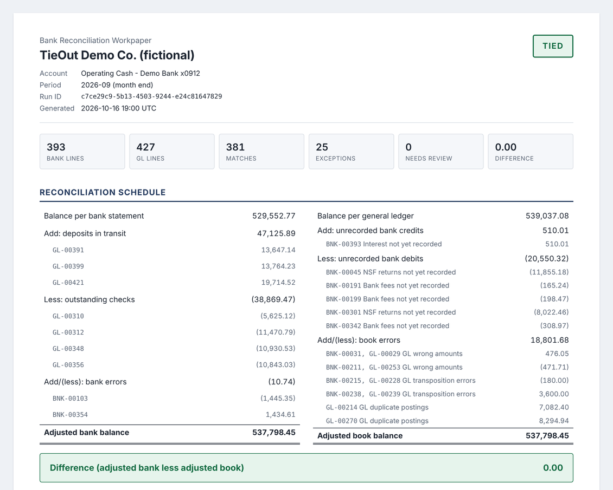
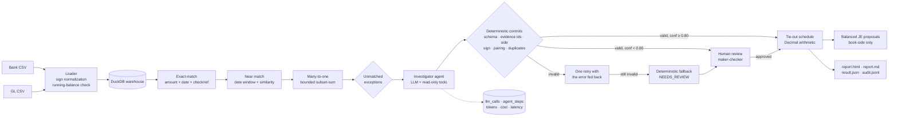

# TieOut

[](https://github.com/sahtirn/Tieout/actions/workflows/ci.yml)


**An auditable AI agent that performs month-end bank reconciliations and ties to the penny, or tells you exactly why it doesn't.**

Deterministic code matches transactions and does every calculation. A tool-using LLM agent investigates only the exceptions, classifies them, and explains them in plain English. Every claim the model makes is checked by code before it can touch the reconciliation. Every call is metered, every step is logged, and accuracy is measured against ground truth in CI.

[](https://htmlpreview.github.io/?https://github.com/sahtirn/Tieout/blob/main/docs/sample/report.html)

> See the output without running anything: [full sample workpaper (rendered)](https://htmlpreview.github.io/?https://github.com/sahtirn/Tieout/blob/main/docs/sample/report.html) · [HTML source](docs/sample/report.html) · [Markdown](docs/sample/report.md) · [eval summary](docs/sample/eval_summary.md) · [audit traces](docs/sample/audit_traces.jsonl)

---

## The problem

Cash reconciliation is one of the most frequent and least loved steps in the close. An analyst exports the bank statement and the GL cash detail, matches hundreds of lines by hand or with brittle spreadsheet formulas, then works the leftovers: Is this a timing difference? A fee nobody booked? A transposed digit? A duplicate posting? The matching is mechanical. The investigation needs judgment, and it has to be documented well enough for a reviewer and an auditor to re-perform it.

TieOut splits that work along the line that matters for a regulated institution: **machines compute, models explain, humans approve.**

## How it works



## Design principles

1. **The model never does the math.** Matching, balances, the reconciliation schedule, and journal entry amounts are computed by deterministic code with `Decimal` money quantized to the cent (ROUND_HALF_UP). Floats are rejected at the boundary and a test fails the build if `float(` appears anywhere in the source.
2. **The model's claims are verified, not trusted.** Every evidence id must exist in the source data (including ids mentioned in prose). The break type must be possible for the item's ledger and sign. A claimed transposition must actually be a two-digit swap. A claimed duplicate must have a twin.
3. **Failure degrades to a human, never to a wrong number.** Invalid output gets one retry with the validation error fed back, then falls back to a deterministic classifier and is flagged NEEDS_REVIEW. Unreviewed items stay out of the schedule, so the rec reports UNRECONCILED with the exact amount at stake. The difference is never plugged.
4. **Data minimization.** The agent sees one exception and the small, capped results of tools it chooses to call. It never receives a full ledger.
5. **Everything is observable.** Each LLM call records provider, model, prompt version, tokens, latency, estimated cost, retries, and errors. Each tool call is an `agent_steps` row. Each run records input file hashes, a config snapshot (secrets excluded), and the git commit.
6. **Measured, not asserted.** `tieout eval` scores the full pipeline against generated ground truth across seeds and fails CI below thresholds.

## Controls

| Control | What it guarantees | Where it is enforced |
| --- | --- | --- |
| Deterministic math | All amounts are Decimal cents; floats refused; no model arithmetic | [`money.py`](src/tieout/money.py), [`schedule.py`](src/tieout/schedule.py), [`journal.py`](src/tieout/journal.py), `test_no_float_calls_in_source` |
| Input integrity | Running balances must foot line by line; duplicate ids refused | [`io.py`](src/tieout/io.py) `_check_running_balance` |
| One match per item | Each item matched at most once, enforced by a primary key | [`warehouse/duckdb_warehouse.py`](src/tieout/warehouse/duckdb_warehouse.py) `match_items`, [`matching.py`](src/tieout/matching.py) |
| Evidence validation | Cited ids exist; side, sign, pairing, digit-swap, and duplicate claims re-verified | [`agent/validation.py`](src/tieout/agent/validation.py) |
| Retry then fallback | One corrective retry, then deterministic classifier, flagged NEEDS_REVIEW | [`agent/investigator.py`](src/tieout/agent/investigator.py) |
| Tie-out gate | TIED only at exactly 0.00; only accepted or approved findings count; unexplained items listed | [`schedule.py`](src/tieout/schedule.py) `build_tieout` |
| Balanced JEs | Every proposal balances (model validator); accounts from config; book-side only | [`models.py`](src/tieout/models.py) `JournalEntryProposal`, [`config/accounts.yaml`](config/accounts.yaml) |
| Maker-checker review | Preparer cannot review own run; rejections need a note; append-only decisions | [`review.py`](src/tieout/review.py) `record_review` |
| Audit trail | JSONL trace from source rows to match/exception, agent steps, classification, schedule line, JE, review | [`audit.py`](src/tieout/audit.py) |
| Data minimization | Agent gets one exception; tool results capped at 10 rows | [`agent/policy.py`](src/tieout/agent/policy.py) `ExceptionContext`, [`agent/tools.py`](src/tieout/agent/tools.py) `MAX_RESULTS` |

## Quickstart (mock mode, no API key)

Requires Python 3.11 or newer.

```bash
git clone https://github.com/sahtirn/Tieout && cd Tieout && pip install -e ".[dev]"
tieout generate --seed 42 --month 2026-09 --out data/
tieout reconcile --bank data/bank_statement.csv --gl data/gl_cash.csv
```

That writes `runs/<run_id>/report.html`, `report.md`, and `result.json`. Then try:

```bash
tieout eval --seeds 25            # scored against ground truth; non-zero exit on a miss
tieout audit <run_id>             # JSONL audit trail
tieout review <run_id>            # approve or reject NEEDS_REVIEW items and proposed JEs
tieout telemetry                  # calls, tokens, cost, latency, failure rate, ROI assumption
tieout serve                      # API at http://127.0.0.1:8000/docs
```

### With Gemini

```bash
cp .env.example .env              # set LLM_PROVIDER=gemini and GEMINI_API_KEY=...
tieout reconcile --bank data/bank_statement.csv --gl data/gl_cash.csv
tieout eval --seeds 5 --provider gemini
GEMINI_API_KEY=... pytest -m live
```

The Gemini provider uses the official `google-genai` SDK with manual function calling (mode `ANY`), so the final answer arrives as structured `submit_finding` arguments. It retries 429/5xx/timeouts with exponential backoff and captures token usage for cost telemetry. The default model is `gemini-3.6-flash`; change `GEMINI_MODEL` as models evolve. Temperature is left at the model default, per Google's guidance for Gemini 3 models; set `GEMINI_TEMPERATURE` only if you have measured a reason to.

## Latest eval results

Mock provider, seeds 1 to 25, September 2026, 25 planted breaks per run across nine types (full report: [docs/sample/eval_summary.md](docs/sample/eval_summary.md)).

| Metric | Result | CI threshold |
| --- | ---: | ---: |
| Tie-out rate | 100% | 100% |
| Match precision / recall / F1 | 1.0000 / 1.0000 / 1.0000 | F1 ≥ 0.98 |
| Classification accuracy (625 items) | 1.0000 | ≥ 0.95 |
| Adjusted balance equals ground truth | 100% | |
| NEEDS_REVIEW rate | 0% | |
| Avg wall time per run | about 0.5 s | |

**How to read this honestly.** The mock provider runs a deterministic rule policy through the real agent loop, so a perfect score proves the plumbing, matching engine, controls, and arithmetic. It does not prove LLM quality. Two things make the eval meaningful anyway:

* A **chaos test** (`test_unreliable_model_is_contained_by_controls`) runs the full pipeline with a model that corrupts every answer with hallucinated ids and impossible classifications. Result: 100% of findings routed to review, 100% correct fallback labels, and 0% tie-out, because nothing unreviewed is allowed to count. That is the property a bank needs.
* The same harness scores a live model: `tieout eval --provider gemini`.

A tie alone is not proof of correct classification. Calling a deposit in transit a GL duplicate moves +x off the bank side and -x onto the book side, which leaves the difference unchanged. That is why the evals also check the adjusted balance against ground truth, and why the validator enforces side and sign rules ([DECISIONS D-013](docs/DECISIONS.md)).

## Telemetry example

`tieout telemetry --json` after the seed 42 sample run:

```json
{
  "totals": {
    "runs": 1,
    "calls": 85,
    "failed_calls": 0,
    "failure_rate": 0.0,
    "input_tokens": 137391,
    "output_tokens": 2737,
    "cost_usd": "0.000000",
    "retries": 0,
    "analyst_minutes_saved_ASSUMPTION": "649.5",
    "analyst_value_usd_ASSUMPTION": "703.63"
  }
}
```

The mock costs nothing. At the estimated Flash prices in [`config/pricing.yaml`](config/pricing.yaml), the same token volume would cost about $0.08 per reconciliation. Minutes saved come from per-item assumptions in [`config/assumptions.yaml`](config/assumptions.yaml) and are labeled as assumptions everywhere they appear. Prices and assumptions should be verified before anyone quotes them.

## Sign convention

Every amount is signed **from the cash account's perspective**: deposits and debits to cash are positive; withdrawals and credits to cash are negative. The bank CSV is already signed this way. The GL CSV has debit and credit columns and is normalized on load as `amount = debit - credit`. The schedule is:

```
Adjusted bank balance = ending bank balance + deposits in transit - outstanding checks +/- bank errors
Adjusted book balance = ending GL balance + unrecorded bank credits - unrecorded bank debits +/- book errors
```

Because amounts are signed, "less outstanding checks" is the addition of negative amounts, and every bucket is a simple sum.

## What the synthetic data looks like

`tieout generate` builds one month of roughly 400 bank lines and 420 GL lines for a fictional company: ACH vendor payments, checks that clear one to three days later, customer wires and ACH receipts, card settlements, payroll, and batch deposits where one bank deposit equals 2 to 5 GL receipts. Bank descriptions are truncated and abbreviated (`ACH DEBIT BRIGHTLINE OFC SPLY` vs `ACH Payment - Brightline Office Supply`). It plants a configurable number of each break type, and every break carries the evidence an accountant would use:

| Break type | Evidence planted |
| --- | --- |
| Deposit in transit | GL receipt in the last two business days, no bank deposit |
| Outstanding check | GL check in our series issued late in the month, not cleared |
| Bank fee / interest | Standard bank descriptions |
| NSF return | `RETURNED ITEM NSF CHK 4053 ...` citing a customer check deposited earlier |
| GL duplicate | Same invoice and ACH trace posted twice, one to four days apart |
| GL transposition | GL amount is the bank amount with two adjacent digits swapped |
| GL wrong amount | GL memo shows the invoice amount, which equals the bank amount |
| Bank error | Bank adjustment notice reference (`ADJN...`) on an item that is not ours |

`labels.json` holds the ground-truth matches, breaks, and expected adjusted balance. The same seed produces byte-identical files.

## Project layout

```
src/tieout/
  money.py, models.py, config.py        Decimal money, domain models, settings
  generator.py, io.py                   synthetic data, CSV loading and integrity checks
  warehouse/                            Warehouse port, DuckDB implementation, Snowflake stub
  matching.py, similarity.py            exact, near, and many-to-one passes
  schedule.py, journal.py               tie-out schedule and balanced JE proposals
  agent/                                tools, policy, validation, investigator loop, providers
  telemetry.py, audit.py, review.py     cost and ROI, JSONL audit trail, maker-checker
  report.py, templates/                 HTML and Markdown workpapers
  evals.py, api.py, cli.py              eval harness, FastAPI app, Typer CLI
config/      pricing (estimates), accounts, eval thresholds, ROI assumptions
prompts/     investigator_v1.md (version recorded on every call)
docs/        DECISIONS.md, sample outputs
```

Design decisions, alternatives, and rationale are logged in [docs/DECISIONS.md](docs/DECISIONS.md).

## Roadmap

* **Snowflake port using Cortex.** Implement `SnowflakeWarehouse` (the stub documents the DDL and query changes) and run the investigator on Snowflake Cortex so ledger data never leaves the account boundary.
* **LangGraph orchestration.** Express the investigate, validate, retry, fallback, and review loop as an explicit graph with checkpointing and human-in-the-loop interrupts.
* **Langfuse tracing.** Export `llm_calls` and `agent_steps` as traces and spans for prompt comparison and cost dashboards.
* **Multi-account support.** Many cash accounts per run, intercompany sweeps, and a portfolio-level close dashboard.
* Prior-period carry-forward of outstanding items, bank-format adapters (BAI2, camt.053), and SSO-backed reviewer identity.

## Limitations

* Single cash account, single month, and the prior period is assumed fully cleared.
* All data is synthetic. Real bank feeds are messier: partial payments, reversed and re-presented items, FX, lockbox files, and banks that change description formats without notice.
* Perfect mock eval scores reflect a rule policy designed alongside the generator. Live-model accuracy must be measured separately, and the agent prompt has not been tuned against a live model in this repository.
* LLM prices and ROI figures are estimates and assumptions, clearly labeled, and must be verified.
* Reviewer identity is a name string; production use needs SSO-backed identity and role-based access.
* DuckDB is single-writer; the API serializes writes within one process.

## Disclaimer

All data in this repository is synthetic and generated from a random seed. Company, vendor, and customer names are fictional; any resemblance to real entities is coincidental. This is a personal portfolio project, unaffiliated with and not endorsed by any employer, bank, or vendor.

## License

MIT. See [LICENSE](LICENSE).
